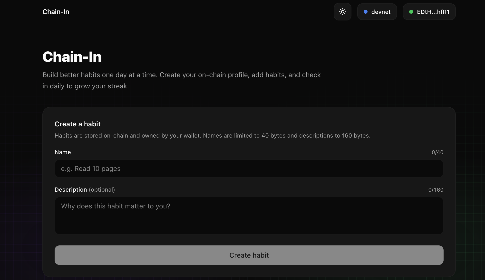
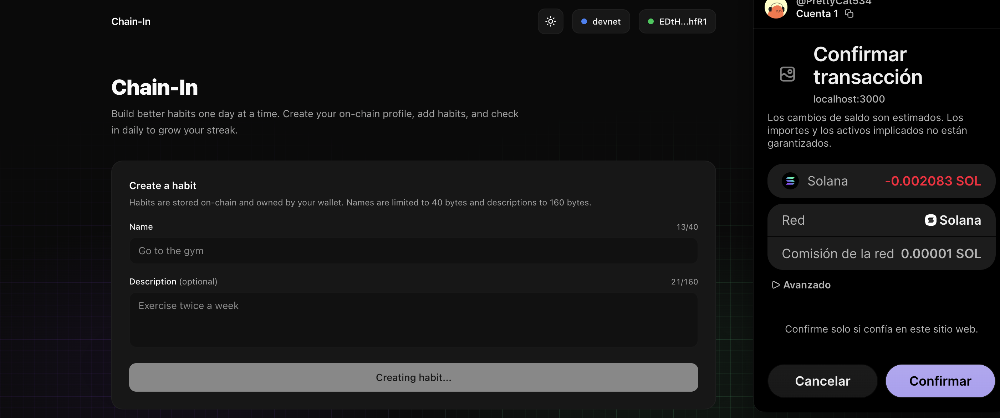
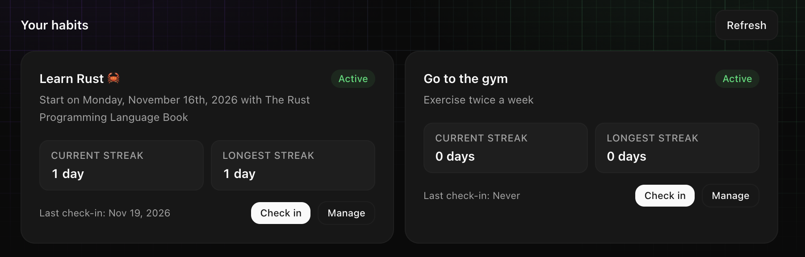
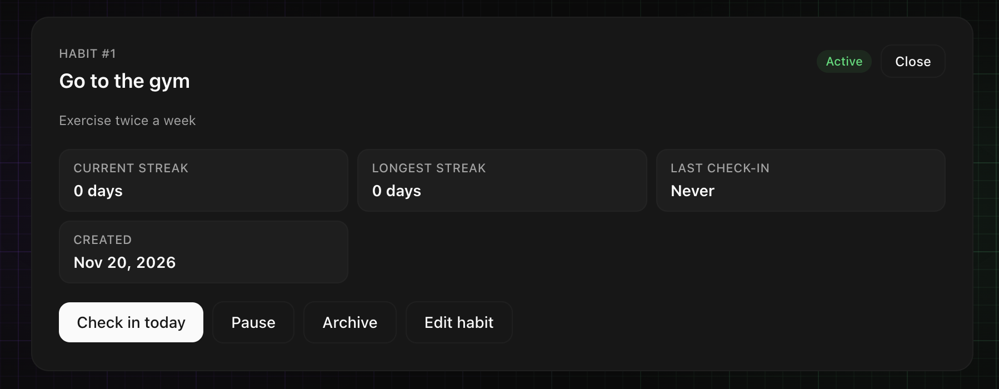
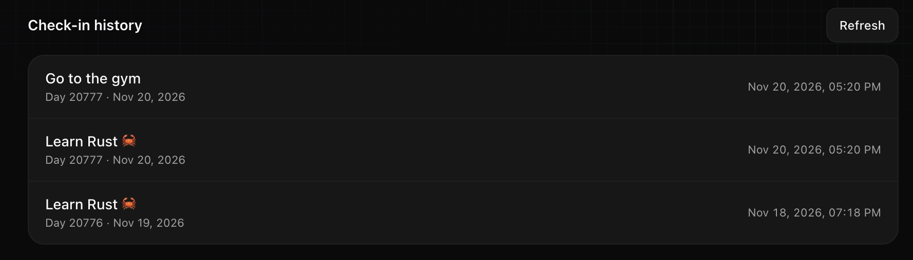

# Chain-In

**Ruta de proyecto propio** — seguimiento de hábitos diarios sobre Solana.

- **Autora:** Gianella Xiomara Coronel Manchego
- **Correo de registro:** gia.ne12@hotmail.com

## Descripción

Chain-In es una aplicación de seguimiento de hábitos diarios construida sobre Solana. Cada usuario crea un perfil on-chain, registra hábitos y realiza un check-in por día. El programa garantiza que solo el dueño de un hábito pueda modificarlo, que los check-ins sean únicos por día y que el cierre de cuentas devuelva la rent al propietario.

El contrato está desplegado en **Devnet**. El frontend **no se despliega**: se ejecuta localmente contra Devnet.

## Propósito

Demostrar un flujo completo entre un programa Anchor y un frontend Next.js:

- Estado persistido on-chain (perfil, hábitos e historial de check-ins).
- Reglas de negocio aplicadas por el programa, no por la interfaz.
- Firma, confirmación y refresco de datos tras cada transacción.
- Manejo de errores del programa con mensajes claros.

## Programa en Devnet

| Dato       | Valor                                                                                           |
| ---------- | ----------------------------------------------------------------------------------------------- |
| Program ID | `Eai82xNfih16jrTcQktnKaAYWG9hkvUuQ6uRGPtDsWwM`                                                  |
| Red        | Devnet                                                                                          |
| Explorer   | https://explorer.solana.com/address/Eai82xNfih16jrTcQktnKaAYWG9hkvUuQ6uRGPtDsWwM?cluster=devnet |

Instrucciones expuestas: `initialize_profile`, `create_habit`, `update_habit`, `check_in`, `pause_habit`, `resume_habit`, `archive_habit`, `close_habit`.

## Configuración

**Stack**

- Programa: Rust + Anchor.
- Frontend: Next.js 16, TypeScript, Tailwind CSS v4.
- Cliente Solana: `@solana/kit` v8, `@solana/kit-plugin-wallet` y `@solana/react`.
- Pruebas: Vitest.

**Requisitos**

- Node.js 24 o superior.
- Wallet compatible con Wallet Standard y fondos en Devnet ([faucet.solana.com](https://faucet.solana.com/)).

**Estructura**

```text
anchor/    Programa Anchor y pruebas LiteSVM
app/       Frontend Next.js (UI, cliente Chain-In y hooks)
tests/     Pruebas del frontend con Surfpool
```

**Red**

El frontend inicia en Devnet y permite cambiar de red. La aplicación solo opera contra Devnet y Localnet: el programa no está desplegado en Mainnet ni Testnet.

## Pasos de ejecución

1. Instalar dependencias:

```shell
pnpm install
```

2. Iniciar el frontend:

```shell
pnpm run dev
```

3. Abrir http://localhost:3000 y conectar una wallet en Devnet con fondos.

4. Crear el perfil y comenzar a registrar hábitos.

**Comandos de verificación**

```shell
pnpm run typecheck   # TypeScript
pnpm run lint        # ESLint
pnpm run build       # Build de producción
pnpm run test        # Pruebas automatizadas
```

**Programa (opcional)**

```shell
cd anchor
anchor build
anchor deploy --provider.cluster devnet
```

## Flujo de uso

1. Conectar la wallet en Devnet.
2. Crear el perfil on-chain (`initialize_profile`).
3. Crear un hábito con nombre (máx. 40 bytes UTF-8) y descripción (máx. 160 bytes).
4. Realizar el check-in diario; el programa valida que sea el día UTC actual.
5. Editar el hábito, pausarlo, reanudarlo o archivarlo según su estado.
6. Cerrar un hábito archivado para recuperar la rent.
7. Consultar el historial de check-ins, incluidos los de hábitos cerrados.

## Aporte propio

El aporte identificable es la integración completa del programa con el frontend, sin generadores de código ni dependencias adicionales:

- **Cliente Chain-In tipado a mano** sobre `@solana/kit`: IDs de programa, discriminadores, codecs Borsh, PDAs y las 8 instrucciones. Se eligió esta ruta frente a Codama por el tamaño reducido del programa (3 cuentas, 8 instrucciones) y para mantener el control explícito de roles y seeds.
- **Validación alineada con el contrato**: los límites de 40/160 bytes se miden en UTF-8, igual que Anchor, y se aplican antes de firmar.
- **Reglas críticas verificadas en el programa**: `profile.authority` para crear hábitos, `has_one = owner` en todas las operaciones sobre hábitos, y `close = owner` con estado `Archived` para cerrar cuentas.
- **Consistencia de datos**: cada acción refresca perfil, hábitos e historial desde la cadena; la UI nunca asume el resultado de una transacción.
- **Manejo de errores**: mapeo de los códigos del programa (6000–6011) a mensajes de usuario, con fallback para check-ins duplicados.

## Cómo probarlo

**Prueba manual (Devnet)**

1. Ejecutar `pnpm run dev`.
2. Conectar una wallet con SOL de Devnet.
3. Completar el flujo: perfil → hábito → check-in → editar → pausar/reanudar → archivar → cerrar.
4. Verificar en el Explorer que las cuentas `Profile`, `Habit` y `DailyCheckIn` existen y reflejan los cambios.

**Qué comprobar**

- Solo el dueño puede modificar su hábito (una wallet distinta recibe error de autoridad).
- Un hábito pausado o archivado no acepta check-ins.
- No se puede registrar más de un check-in por día.
- Cerrar un hábito archivado elimina la cuenta y devuelve la rent.
- El historial conserva el nombre del hábito aunque la cuenta se haya cerrado.

La suite `pnpm run test` cubre el flujo base del starter. El flujo Chain-In se comprueba con los pasos anteriores.

## Capturas de pantalla

#### Wallet conectada y perfil creado



#### Creación de hábito



#### Lista de hábitos con rachas



#### Detalle y acciones del hábito



#### Historial de check-ins



## Transacciones verificables

- Crear un hábito: https://explorer.solana.com/tx/49KYkEkFytJ7tPFfBwycjeZPGPGY3mFtU8fZLXZWsWiMNRUoWAR5pWDJdSuNre2QV2cHCamHwafnJWpm3oPJG9FF?cluster=devnet
- Hacer check-in: https://explorer.solana.com/tx/jpmyqm1Gy2dZEALPTLuF6pzzhUJXSSY2KkHB8zxkHqn91TpyYkMhUajtsZB7iB7EnBmr2NekQ6NbYXnpbe6CimY?cluster=devnet
